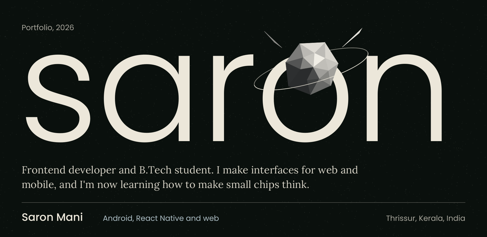
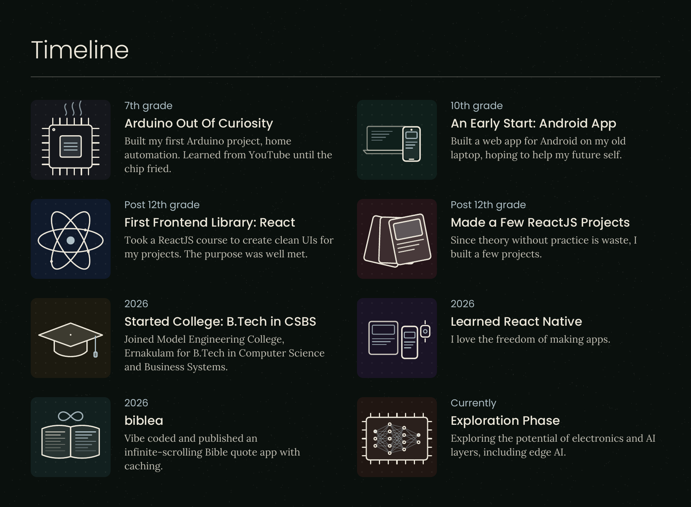
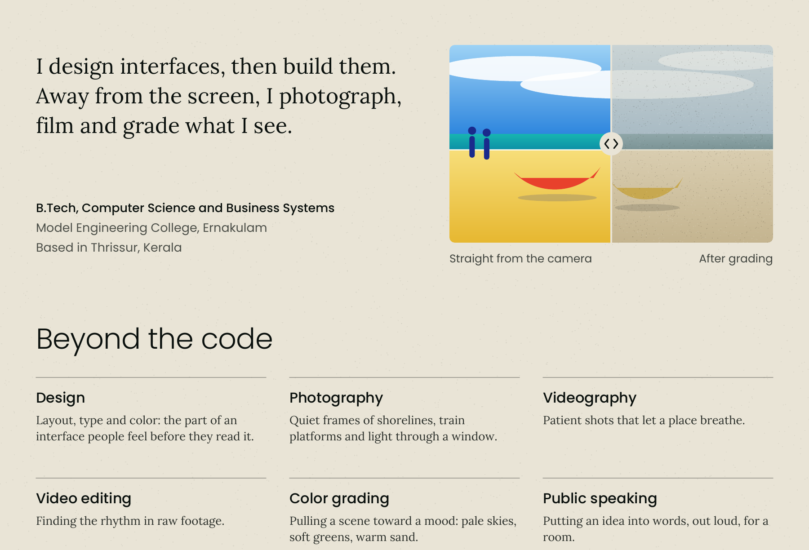

  

  
  
  

  

  

  <a href="https://saron.is-a.dev">saron.is-a.dev</a> ·
  <a href="https://www.linkedin.com/in/saron-mani">LinkedIn</a> ·
  <a href="https://www.instagram.com/saronmani_/">Instagram</a>

